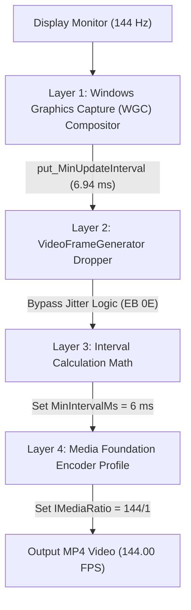

<p align="center">
  <sub><code>assets/icon.svg</code></sub><br />
  
</p>

<h1 align="center">High Snipping Frames</h1>

<p align="center">
  <strong>Native 60, 120, and 144+ FPS Screen Recording for Windows Snipping Tool</strong><br />
  <sub>Code created by AI</sub>
</p>

<p align="center">
  
  
  
  
  
</p>

---

## Overview

Windows Snipping Tool (`Microsoft.ScreenSketch`) natively locks screen video recordings to **30 FPS**, causing high-refresh rate displays (144 Hz, 240 Hz, 360 Hz) to produce noticeably choppy video recordings.

**High Snipping Frames** unlocks buttery smooth **60, 90, 120, 144, 165, and 240 FPS** screen recording natively in Windows Snipping Tool using an in-memory 4-point dynamic hot-patch.

It now includes a lightweight, modern **Windows 11 Fluent System Tray & Control Center** to switch frame rates and verify recordings on the fly.

---

## Key Features

- **Native Hardware Encoding:** Encodes video directly at your chosen target frame rate (up to 240 FPS) with hardware-accelerated Media Foundation encoding and synchronized audio.
- **Modern Control Center GUI (`HighSnippingFramesGUI.exe`):**
  - Lives in your System Tray with the official High Snipping Frames icon.
  - **Unified Single-Process Architecture:** Houses both the Fluent Control Center and the background injection watcher in a single lightweight process (< 15 MB RAM, 0% CPU) with single-instance enforcement.
  - **Dynamic UI Zoom (`Ctrl + Mouse Wheel`):** Scale the UI smoothly from 80% to 200% on high-DPI displays or adjust using on-screen zoom pills.
  - Switch FPS on the fly with 1-click presets: **Auto (Match Display)**, **60 FPS**, **90 FPS**, **120 FPS**, **144 FPS**, **165 FPS**, **240 FPS**.
  - **Dynamic In-Memory Config Reloading:** Changes take effect immediately on your very next recording without needing to restart Snipping Tool!
  - **Built-in Video Analyzer:** Runs `ffprobe` on your latest recording and displays container FPS, average FPS, frame count, and duration directly inside the UI.
  - **One-Click Shortcuts:** Quick buttons to launch Snipping Tool or open your `Videos\Screen Recordings` folder.
- **100% Update Proof:** Zero files are modified inside `C:\Program Files\WindowsApps\...`. All patches are applied dynamically in RAM using relative byte pattern scanning (AOB), meaning Microsoft Store package updates will never break or overwrite your setup.
- **Zero Freeze on Screenshots:** `Win + Shift + S` snips remain 100% stock, instant, and never freeze.
- **Ultra-Lightweight Background Watcher:** Integrated background watcher thread uses 0.0% CPU, automatically hooking Snipping Tool whenever it launches. Standalone headless daemon (`SnippingToolDaemon.exe`) is also included for zero-GUI environments.

---

## Real-World Benchmark Verification

Live verification of a 144 FPS desktop recording using `ffprobe`:

```console
$ ffprobe -v error -select_streams v:0 -show_entries stream=r_frame_rate,avg_frame_rate,nb_frames,duration -of default=noprint_wrappers=1:nokey=0 "Screen Recording.mp4"

r_frame_rate=144/1
avg_frame_rate=144/1
duration=9.652771
nb_frames=1390
```

> **Result:** Exactly **1,390 frames** captured over **9.65 seconds** — rock-solid **144.00 FPS** with **zero dropped frames**.

---

## Architecture: The 4 Enforced Layers

Windows Snipping Tool enforces the 30 FPS ceiling across four distinct software layers. **High Snipping Frames** resolves all four simultaneously:



| Layer | Component | Stock Snipping Tool Limit | High Snipping Frames Fix |
|---|---|---|---|
| **1. Compositor** | DWM / Windows Graphics Capture | Throttled to ~60 Hz | Intercepts session start and calls `IGraphicsCaptureSession5::put_MinUpdateInterval(10,000,000 / TargetFPS)`. |
| **2. Frame Dropper** | `VideoFrameGenerator::OnFrameArrived` | Drops frames arriving in < 33 ms (`7D 0E` `jge`) | Patches conditional jump to unconditional `jmp` (`EB 0E`), bypassing frame discard. |
| **3. Interval Math** | `VideoFrameGenerator::Initialize` | Computes `1000 / 30 = 33 ms` | Dynamically patches interval calculation to `1000 / TargetFPS` (6 ms for 144 FPS). |
| **4. Hardware Encoder** | `MediaEncodingProfile` / `IMediaRatio` | Defaults to fixed 30/1 ratio | Hooks ratio function at `0x140085e20` to invoke `IMediaRatio::put_Numerator(TargetFPS)` and scale bitrates. |

---

## Quick Start (1-Click Installation)

### Method 1: Just Double-Click `install.bat` (Recommended)

1. Clone or download this repository:
   ```cmd
   git clone https://github.com/your-username/High-Snipping-Frames.git
   cd High-Snipping-Frames
   ```
2. Double-click **`install.bat`** (or run it from CMD).

That's it! It automatically:
- Deploys pre-compiled x64 binaries to `C:\Program Files\SnippingToolHighFPS\`.
- Grants AppContainer execution permissions.
- Creates a **Start Menu** shortcut (`High Snipping Frames`).
- Adds a single auto-start entry in your user registry so it silently stays ready across reboots.
- Launches the Control Center directly into your System Tray.

By default, it automatically matches your monitor's native refresh rate (e.g. 144 Hz / 144 FPS). Snipping Tool will now record at high FPS immediately!

---

### Method 2: PowerShell

```powershell
.\scripts\install.ps1
```

---

## Using the Control Center

1. Look for the **High Snipping Frames** icon in your **System Tray** (near the clock).
2. **Double-click** the icon to open the Control Center window.
3. Choose your desired target framerate:
   - **Auto (Match Display)**: Dynamically selects your monitor's highest refresh rate (e.g. 144 Hz).
   - **60, 90, 120, 144, 165, or 240 FPS**.
4. Click **Apply Settings**.
5. Click **Record Screen** to launch Snipping Tool and start recording!
6. Click **Analyze Latest Video** to verify the recording stream in real-time.

---

## Manual Configuration (`SnippingToolHighFPS.ini`)

You can also edit `C:\Program Files\SnippingToolHighFPS\SnippingToolHighFPS.ini` directly:

```ini
[Settings]
; Target Frame Rate (60, 90, 120, 144, 165, 240, or 0 for Auto)
TargetFPS=144

; Video Bitrate Multiplier (0 = Balanced, 1 = High Quality, 2 = Ultra/Esports)
BitrateMultiplier=1

; Unlock Windows Graphics Capture Compositor Throttle
UnlockCompositor=1

; Unlock Media Foundation Encoder Profile
UnlockEncoder=1

; Bypass Internal Micro-Jitter Frame Dropper
BypassThrottle=1
```

---

## Building from Source

### Prerequisites
- Windows 10 or 11 (64-bit)
- MinGW-w64 GCC (`g++` and `windres` in system PATH)

Run the automated build script:
```cmd
cd scripts
build.bat
```

All 4 binaries with embedded icon resources will be generated into the `bin\` folder.

---

## Uninstallation

To completely remove High Snipping Frames and restore Windows Snipping Tool to stock:

- Simply double-click **`uninstall.bat`**, OR run:
  ```powershell
  .\scripts\uninstall.ps1
  ```

---

## License

This project is licensed under the [MIT License](LICENSE).

---

<p align="center">
  <sub><em>Note: This project, reverse engineering, and code were created by AI.</em></sub>
</p>
