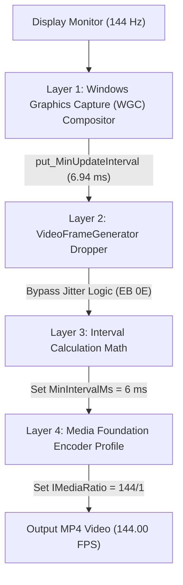

<p align="center">
  
</p>

<h1 align="center">High Snipping Frames</h1>

<p align="center">
  <strong>Native 60, 120, and 144+ FPS Screen Recording for Windows Snipping Tool</strong>
</p>

<p align="center">
  
  
  
  
</p>

---

## Overview

Windows Snipping Tool (`Microsoft.ScreenSketch`) natively locks screen video recordings to **30 FPS**, causing high-refresh rate displays (144 Hz, 240 Hz, 360 Hz) to produce noticeably choppy video recordings.

**High Snipping Frames** unlocks buttery smooth 60, 120, and 144 FPS screen recording natively in Windows Snipping Tool using an in-memory 4-point dynamic hot-patch.

### Key Highlights
- **100% Native Output:** Output MP4 files are hardware-encoded directly at your desired target frame rate (up to 144 FPS) with perfectly synced audio.
- **Update Proof:** Zero files are modified inside `C:\Program Files\WindowsApps\...`. All patches are applied dynamically in RAM using relative byte pattern scanning (AOB), meaning Microsoft Store package updates will never break or overwrite your setup.
- **Zero Freeze on Screenshots:** `Win + Shift + S` snips remain 100% stock, instant, and never freeze.
- **Silent Background Watcher:** Lightweight daemon service (`< 4 MB` RAM, `0.0%` CPU) automatically detects when Snipping Tool opens and unlocks the high-FPS pipeline.

---

## Real-World Benchmark Verification

Verification of an active 144 FPS desktop recording using `ffprobe`:

```console
$ ffprobe -v error -select_streams v:0 -show_entries stream=r_frame_rate,avg_frame_rate,nb_frames,duration -of default=noprint_wrappers=1:nokey=0 "Screen Recording.mp4"

r_frame_rate=144/1
avg_frame_rate=144/1
duration=9.652771
nb_frames=1390
```

> **Result:** Exactly **1,390 frames** captured over **9.65 seconds** — rock-solid **144.00 FPS** with **zero dropped frames**.

---

## How It Works: The 4 Enforced Layers

Windows Snipping Tool enforces the 30 FPS ceiling across four distinct software layers. **High Snipping Frames** resolves all four simultaneously:



| Layer | Component | Stock Snipping Tool Limit | High Snipping Frames Fix |
|---|---|---|---|
| **1. Compositor** | DWM / Windows Graphics Capture | Throttled to ~60 Hz | Intercepts session start and calls `IGraphicsCaptureSession5::put_MinUpdateInterval(10,000,000 / TargetFPS)`. |
| **2. Frame Dropper** | `VideoFrameGenerator::OnFrameArrived` | Drops frames arriving in < 33 ms (`7D 0E` `jge`) | Patches conditional jump to unconditional `jmp` (`EB 0E`), bypassing frame discard. |
| **3. Interval Math** | `VideoFrameGenerator::Initialize` | Computes `1000 / 30 = 33 ms` | Dynamically patches interval calculation to `1000 / TargetFPS` (6 ms for 144 FPS). |
| **4. Hardware Encoder** | `MediaEncodingProfile` / `IMediaRatio` | Defaults to fixed 30/1 ratio | Hooks ratio function at `0x140085e20` to invoke `IMediaRatio::put_Numerator(TargetFPS)` and scale bitrates. |

---

## Quick Start (Installation)

### Method 1: Automated 1-Click Install (PowerShell)

Open PowerShell and run:

```powershell
# Clone or download the repository
git clone https://github.com/your-username/High-Snipping-Frames.git
cd High-Snipping-Frames

# Run the installer
.\scripts\install.ps1
```

The script will:
1. Deploy binaries to `C:\Program Files\SnippingToolHighFPS\`
2. Configure AppContainer read/execute permissions
3. Register the background watcher in `HKCU\Software\Microsoft\Windows\CurrentVersion\Run`
4. Start the watcher immediately

---

## Configuration (`SnippingToolHighFPS.ini`)

Edit `C:\Program Files\SnippingToolHighFPS\SnippingToolHighFPS.ini` (or `bin\SnippingToolHighFPS.ini`):

```ini
[Settings]
; Target Frame Rate
; Options: 60, 120, 144, or 0 (Auto-detects primary monitor refresh rate)
TargetFPS=144

; Unlock Windows Graphics Capture Compositor Throttle
UnlockCompositor=1

; Unlock Media Foundation Encoder Profile
UnlockEncoder=1

; Bypass Internal Micro-Jitter Frame Dropper
BypassThrottle=1
```

---

## Verification

To verify that your installation is working:

1. Open **Snipping Tool** and switch to video recording mode.
2. Record 5–10 seconds of a high-motion scene (e.g. [testufo.com](https://testufo.com)).
3. Stop the recording and run our verification script:
   ```powershell
   .\scripts\verify_fps.ps1
   ```
4. Confirm that `r_frame_rate=144/1` (or 60/1, 120/1).

---

## Building from Source

### Prerequisites
- Windows 10 or 11 (64-bit)
- MinGW-w64 GCC (`g++` in system PATH)

Run the build script:
```cmd
cd scripts
build.bat
```

Or compile manually:
```cmd
:: Build High-FPS Injector DLL
g++ -O2 -shared -o bin\SnippingToolHighFPS.dll src\SnippingToolHighFPS.cpp -lole32 -luuid -static -s

:: Build Background Watcher Daemon
g++ -O2 -mwindows -municode -o bin\SnippingToolDaemon.exe src\SnippingToolDaemon.cpp -static -s

:: Build Launcher Stub
g++ -O2 -mwindows -municode -o bin\SnippingToolLauncher.exe src\SnippingToolLauncher.cpp -static -s
```

---

## Uninstallation

To restore Windows Snipping Tool to stock settings:

```powershell
.\scripts\uninstall.ps1
```

---

## License

This project is licensed under the [MIT License](LICENSE).
